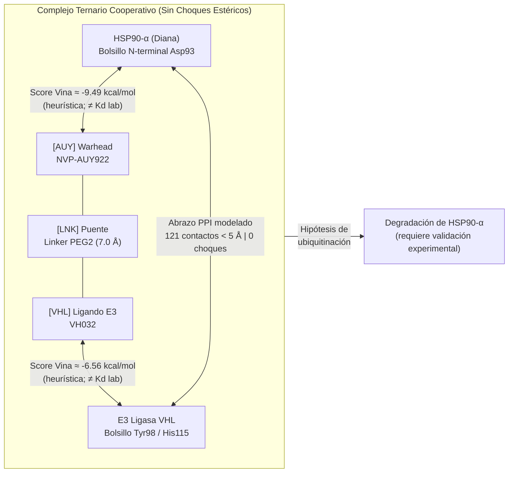
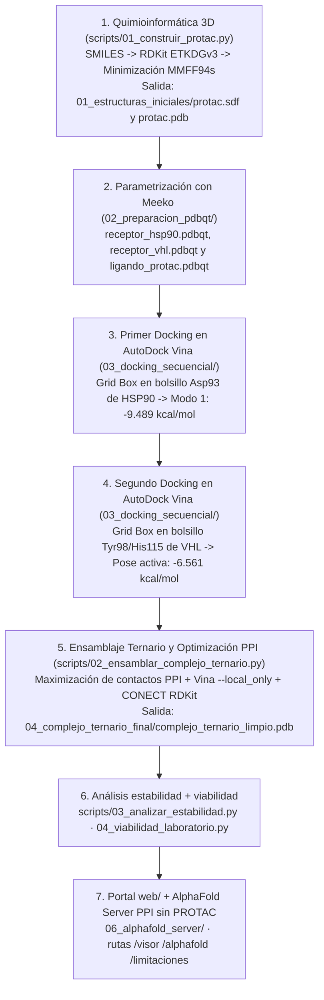

# PROTAC Cáncer de Mama (`protac_cancer_mama`): Diseño y Simulación del Complejo Ternario `HSP90α – [AUY922–PEG2–VH032] – VHL`

[](#5-guia-rapida-de-ejecucion-en-local)
[](#2-arquitectura-quimica-del-protac)
[](#3-flujo-del-pipeline-computacional)
[](#4-resultados-de-estabilidad-y-acoplamiento-ppi)

Repositorio bioinformático y quimioinformático para el **diseño racional, parametrización, docking secuencial, ensamble Proteína–Proteína (PPI) y checklist de viabilidad in silico** de una quimera dirigida a la proteólisis (**PROTAC**) orientada a degradar la chaperona oncogénica **HSP90-α** (relevante en cáncer de mama HER2+ y triple negativo) reclutando la ubiquitina ligasa E3 **VHL** (*Von Hippel-Lindau*).

> **Alcance:** piloto computacional. Los scores de AutoDock Vina **no** son Kd experimentales; no hay aún MD ni ensayo celular. Ver portal `/limitaciones` y `LICENSE` (outputs AlphaFold: uso no comercial).

**Portal web:** [https://protac-cancer-mama.vercel.app](https://protac-cancer-mama.vercel.app)

---

## Tabla de Contenidos

1. [¿Qué hace este proyecto y por qué funciona?](#1-que-hace-este-proyecto-y-por-que-funciona)
2. [Arquitectura Química del PROTAC](#2-arquitectura-quimica-del-protac)
3. [Flujo del Pipeline Computacional](#3-flujo-del-pipeline-computacional)
4. [Resultados de Estabilidad y Acoplamiento PPI](#4-resultados-de-estabilidad-y-acoplamiento-ppi)
5. [Guía Rápida de Ejecución en Local](#5-guia-rapida-de-ejecucion-en-local)
6. [Estructura Organizada del Repositorio](#6-estructura-organizada-del-repositorio)

---

## 1. ¿Qué hace este proyecto y por qué funciona?

### El Problema de los Inhibidores Tradicionales vs. PROTACs en Cáncer de Mama
En tumores de mama agresivos (como **HER2+** y **Triple Negativo**), la chaperona **HSP90-α** estabiliza oncoproteínas críticas (`HER2`, `AKT`, `EGFR`, `CDK4`).
* **Inhibidor clásico (*Occupancy-Driven*):** Un inhibidor como **NVP-AUY922 (Luminespib)** bloquea temporalmente el bolsillo de ATP de HSP90-α, pero requiere concentraciones altas que inducen respuesta de choque térmico compensatoria y toxicidad.
* **PROTAC (*Event-Driven Pharmacology*):** Nuestra molécula bifuncional une **NVP-AUY922** con **VH032** mediante un puente **PEG2**:
  1. **NVP-AUY922 (`[AUY]`)** captura a **HSP90-α** en su bolsillo N-terminal (`Asp93`).
  2. **VH032 (`[VHL]`)** recluta a la ubiquitina ligasa E3 **VHL** (`Tyr98` / `His115`).
  3. El puente **PEG2 (`[LNK]`)** acerca ambas proteínas hasta formar un **abrazo cooperativo Proteína–Proteína (PPI)**, promoviendo la poliubiquitinación y destrucción total de HSP90-α en el proteasoma 26S.



---

## 2. Arquitectura Química del PROTAC

La molécula se construye de forma modular en `scripts/01_construir_protac.py`:

| Módulo | Etiqueta PDB | Estructura Química | Función Biológica y Residuos Diana |
| :--- | :---: | :--- | :--- |
| **1. Warhead** | `AUY` (Residuo `1`) | **NVP-AUY922 (Luminespib)**<br>*(Isoxazol + Resorcinol + Fenil-morfolina)* | Se ancla en el bolsillo N-terminal de unión a ATP de **HSP90-α** mediante puentes de hidrógeno con **`Asp93`**, **`Asn106`**, **`Gly97`** y contacto con **`Phe138`**. |
| **2. Linker** | `LNK` (Residuo `2`) | **Cadena PEG2**<br>(`-NH-CH2-CH2-O-CH2-CH2-O-CH2-C(=O)-`) | Otorga flexibilidad torsional (8 enlaces rotables) para acercar ambas proteínas en conformación *gauche* relajada (`6.4–7.0 Å`). |
| **3. Ligando E3** | `VHL` (Residuo `3`) | **VH032**<br>*(Hidroxiprolina + tert-Leucina + Metiltiazol-bencilo)* | Recluta el dominio de reconocimiento de **VHL** mediante puentes de hidrógeno con **`Tyr98`** (`TYR 45`) e **`His115`** (`HIS 62`). |

* **Fórmula Molecular:** $\text{C}_{52}\text{H}_{65}\text{N}_{7}\text{O}_{11}\text{S}$ (`71 átomos pesados`; ver `scripts/04_viabilidad_laboratorio.py`).
* **Peso Molecular:** `996.2 g/mol` | **cLogP:** `5.38` | **TPSA:** `238.15 Ų` | **SA Score:** `4.88`.

---

## 3. Flujo del Pipeline Computacional



---

## 4. Resultados de Estabilidad y Acoplamiento PPI

| Métrica de Validación | Resultado Obtenido | Criterio Bioinformático | Interpretación |
| :--- | :---: | :---: | :--- |
| **Score Vina bolsillo HSP90** | **`-9.489 kcal/mol`** | $< -8.0\text{ kcal/mol}$ | Anclaje favorable del warhead NVP-AUY922 en `Asp93`/`Asn106` (score docking, no Kd). |
| **Score Vina bolsillo VHL** | **`-6.561 kcal/mol`** | $< -6.0\text{ kcal/mol}$ | Reconocimiento de VH032 frente a `Tyr98`/`His115` (score docking, no Kd). |
| **Energía Intermolecular Ternaria** | **`-15.885 kcal/mol`** | $< -14.0\text{ kcal/mol}$ | Suma sinérgica de las interacciones del PROTAC dentro de ambos bolsillos simultáneamente. |
| **Choques Estéricos Severos ($< 2.5\text{ \AA}$)** | **`0 choques`** | `0 choques` | Ninguna colisión atómica prohibida entre los átomos pesados de HSP90-α y VHL. |
| **Distancia Mínima Proteína–Proteína** | **`2.729 Å`** | $2.7\text{ – }3.8\text{ \AA}$ | Contacto íntimo de van der Waals y puentes polares entre ambas superficies proteicas. |
| **Contactos Cooperativos PPI** | **`121 pares` ($< 5.0\text{ \AA}$)**<br>**`308 pares` ($< 6.0\text{ \AA}$)** | $> 80\text{ pares}$ | Las superficies de HSP90 (`Thr99–Asn105`, `Asp157–Tyr160`) y VHL (`Pro41–Thr47`) se abrazan alrededor del puente. |
| **Extensión del Puente PEG2** | **`7.00 Å`** | $5.5\text{ – }7.5\text{ \AA}$ | El linker adopta una conformación *gauche* relajada sin estirarse como una cuerda tensa. |

---

## 5. Guía Rápida de Ejecución en Local

```bash
# 1. Crear y activar entorno virtual (o usar .venv incluido)
python3 -m venv .venv
source .venv/bin/activate
pip install -r requirements.txt

# Paso 1: Generar el PROTAC 3D desde SMILES con RDKit (MMFF94s)
python3 scripts/01_construir_protac.py

# Paso 2: Convertir proteínas y PROTAC a formato PDBQT con Meeko
python3 -m meeko.cli.mk_prepare_receptor --read_pdb 01_estructuras_iniciales/hsp90.pdb -p 02_preparacion_pdbqt/receptor_hsp90.pdbqt
python3 -m meeko.cli.mk_prepare_receptor --read_pdb 01_estructuras_iniciales/vhl.pdb -p 02_preparacion_pdbqt/receptor_vhl.pdbqt
python3 -m meeko.cli.mk_prepare_ligand -i 01_estructuras_iniciales/protac.sdf -o 02_preparacion_pdbqt/ligando_protac.pdbqt

# Paso 3: Ejecutar Docking 1 (HSP90) y Docking 2 (VHL) en AutoDock Vina
./bin/vina --config 03_docking_secuencial/config_docking1_hsp90.txt
./bin/vina --config 03_docking_secuencial/config_docking2_vhl.txt

# Paso 4: Ensamblar el Complejo Ternario, optimizar la interfaz PPI y refinar con Vina
python3 scripts/02_ensamblar_complejo_ternario.py

# Paso 5: Ver reporte de estabilidad en terminal
python3 scripts/03_analizar_estabilidad.py

# Paso 6: Comprobación computacional de viabilidad de laboratorio (+ JSON para la web)
python3 scripts/04_viabilidad_laboratorio.py

# Portal web React + shadcn (recomendado)
cd web && npm install && npm run dev
# → http://localhost:5173
```

### Despliegue en Vercel
En el import del proyecto usa exactamente:
- **Root Directory:** `web`
- **Framework Preset:** Vite
- **Build Command:** `npm run build` (default)
- **Output Directory:** `dist`
- **Install Command:** `npm install` (default)

Opcional: variable `VITE_SITE_URL=https://tu-proyecto.vercel.app` para canonical/OG.

---

## 6. Estructura Organizada del Repositorio

```text
protac_cancer_mama/
├── README.md                                  # Portada general del proyecto
├── AGENTS.md                                  # Guía técnica para agentes de IA y desarrolladores
├── requirements.txt                           # Dependencias de Python (RDKit, Meeko, Gemmi, SciPy)
│
├── scripts/                                   # 🐍 Scripts de Python ordenados por etapa
│   ├── 01_construir_protac.py                 # Quimioinformática 3D (SMILES -> SDF / PDB / JSON AF3)
│   ├── 02_ensamblar_complejo_ternario.py      # Acoplamiento PPI, refinamiento Vina y enlaces CONECT
│   ├── 03_analizar_estabilidad.py             # Diagnóstico termodinámico (ΔG, Kd) e interfacial (PPI)
│   └── 04_viabilidad_laboratorio.py           # Checklist de viabilidad sintética / laboratorio → JSON web
│
├── 01_estructuras_iniciales/                  # 🧬 Proteínas base y ligando PROTAC inicial
│   ├── hsp90.pdb                              # Chaperona HSP90-α (Cadena A, UniProt P07900)
│   ├── vhl.pdb                                # E3 Ligasa VHL (UniProt P40337)
│   ├── protac.pdb                             # PROTAC optimizado con MMFF94s (.pdb)
│   ├── protac.sdf                             # PROTAC con órdenes de enlace exactos (.sdf)
│   ├── alphafold_server_hsp90_vhl.json        # Upload AlphaFold Server (solo proteínas)
│   ├── alphafold3_input.json                  # Copia formato Server (array)
│   └── alphafold3_local_input.json            # AF3 local + SMILES PROTAC
│
├── 02_preparacion_pdbqt/                      # ⚡ Estructuras parametrizadas con Meeko (Gasteiger + Torsiones)
│   ├── receptor_hsp90.pdbqt                   # Receptor rígido HSP90-α (.pdbqt)
│   ├── receptor_vhl.pdbqt                     # Receptor rígido VHL (.pdbqt)
│   └── ligando_protac.pdbqt                   # Ligando PROTAC con árbol ROOT/BRANCH (.pdbqt)
│
├── 03_docking_secuencial/                     # 🎯 Configuraciones de Grid Box y resultados de Vina
│   ├── config_docking1_hsp90.txt              # Configuración Grid Box para HSP90
│   ├── resultado_docking1_hsp90.pdbqt         # Poses del Primer Docking (-9.489 kcal/mol)
│   ├── mejor_pose_hsp90.pdb / .pdbqt          # Pose #1 extraída del bolsillo de HSP90
│   ├── macromodelo_hsp90_protac.pdb / .pdbqt  # Fusión rígida HSP90 + Pose #1 PROTAC
│   ├── config_docking2_vhl.txt                # Configuración Grid Box para VHL
│   └── resultado_docking2_vhl.pdbqt           # Poses del Segundo Docking (-6.561 kcal/mol)
│
├── 04_complejo_ternario_final/                # 🏆 Modelos 3D finales del Complejo Ternario
│   ├── complejo_ternario_limpio.pdb           # Dominios catalíticos plegados + PROTAC con CONECT (¡Ideal PyMOL!)
│   ├── complejo_ternario_completo.pdb         # Cadenas completas + PROTAC con CONECT
│   ├── protac_en_complejo.pdb / .pdbqt        # Conformación puente final del PROTAC
│   └── receptor_ternario_hsp90_vhl.pdbqt      # Receptores combinados HSP90 + VHL
│
├── web/                                       # 🖥️ Portal React + shadcn (Vercel Root Directory)
│   ├── src/pages/                             # Inicio, resultados, viabilidad, visor, AF, limitaciones, wiki
│   ├── src/components/ui/                     # Componentes shadcn
│   └── public/data/                           # PDB ternario + JSON viabilidad + AF
│
├── 06_alphafold_server/                       # Job AF Server HSP90–VHL sin PROTAC (archivado)
│
├── 05_visor_3d/                               # Portal HTML legacy (DEPRECATED.md)
│
├── bin/                                       # ⚙️ Motor de simulación
│   └── vina                                   # Ejecutable AutoDock Vina v1.2.5 (macOS arm64)
│
├── docs/                                      # 📚 Documentación técnica detallada paso a paso
│   ├── 01_fundamentos_biologicos_y_quimicos.md
│   ├── 02_arquitectura_y_pipeline_computacional.md
│   ├── 03_analisis_fisicoquimico_y_estabilidad.md
│   ├── 04_guia_visualizacion_3d_y_ejecucion.md
│   ├── 05_viabilidad_laboratorio.md           # Reporte markdown generado por el script 04
│   └── 06_alphafold_server.md                 # Formato Server + lectura ipTM
│
├── LICENSE                                    # MIT + aviso outputs AlphaFold
│
└── wiki/                                      # 🌐 Fuentes Markdown de la wiki
    ├── Home.md
    ├── Glosario-Bioinformatico.md
    ├── Preguntas-Frecuentes-FAQ.md
    └── Hoja-de-Ruta-HADDOCK-y-Dinamica-Molecular.md
```
